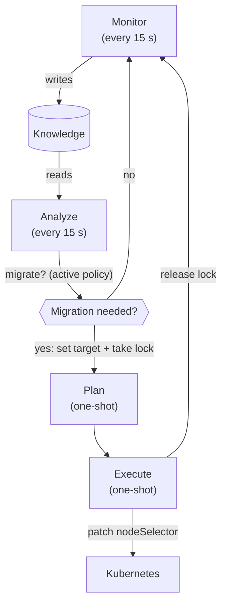

# Anatomy of `cluster_agent.py`

This document explains how `cluster_agent.py` is built and how it works. The agent implements a **MAPE-K** control loop (Monitor, Analyze, Plan, Execute over a shared Knowledge base) on top of the **SPADE** agent platform.

Its goal is to watch the state of an application (`main-app`) in a Kubernetes cluster and migrate it between nodes, either to improve its performance or to escape a degraded node.

For a high-level overview and usage instructions, see the [README](../README.md).

---

## 1. State and memory (the "K" in MAPE-K)

The agent's memory lives in the instance variables of the `ClusterAgent` class. The most important one is `self.knowledge`, a knowledge base shared by every behaviour.

### What `ClusterAgent.setup()` initializes

| Variable | Type | Purpose |
|---|---|---|
| `self.knowledge` | `dict` | Short-term memory with the latest observations of the environment. |
| `self.knowledge['nodes_cpu']` | `dict` | CPU usage per node, e.g. `{'r3-node': 85.1, 'vm1node': 44.2}`. |
| `self.knowledge['qos']` | number | Current value of the `main_app_qos` metric. |
| `self.knowledge['target_node']` | `str` | Node chosen for the next migration. Written by Analyze, read by Plan. |
| `self.current_node` | `str` | The agent's **belief** about where the application currently runs. Starts as `"unknown"`; Monitor verifies and corrects it every cycle. |
| `self.migration_in_flight` | `bool` | A lock. Set to `True` when a migration starts and to `False` when it ends, so a new migration cannot start while another one is in progress. |

Configuration parameters such as `prometheus_url`, `namespace` and `deployment_to_migrate` are also set here.

> **Note on decision parameters.** Earlier versions of the agent kept the decision thresholds (`qos_threshold`, `return_cpu_threshold`) directly in the agent. The decision logic now lives in the pluggable policies described in the README. <!-- TODO: confirm which parameters are still defined in the agent and which moved into the policies. -->

---

## 2. Behaviours

The MAPE cycle is implemented as a set of SPADE behaviours that communicate through the agent's memory.

### Monitor

| | |
|---|---|
| **Type** | `PeriodicBehaviour`, every 15 seconds |
| **Goal** | Perceive the state of the world. These are the agent's senses. |
| **Produces** | Updates `knowledge['nodes_cpu']` and `knowledge['qos']`. |
| **External calls** | Kubernetes API (list pods); HTTP requests to the Prometheus API. |

What it does:

1. **Self-location.** Queries the Kubernetes API for the *real* location of the `main-app` pod and updates `self.current_node`. This is the most important step for robustness: the agent never trusts an outdated belief.
2. **External observation.** Sends concurrent queries to Prometheus for node CPU and application QoS.
3. **Policy watch.** Checks `policy.conf` and hot-swaps the active policy when the filename changes (see the README). <!-- TODO: confirm this check lives in MonitorBehaviour, as the README states. -->

### Analyze

| | |
|---|---|
| **Type** | `PeriodicBehaviour`, every 15 seconds |
| **Goal** | Decide whether to act. This is the agent's brain. |
| **Produces** | If a migration is needed: `knowledge['target_node']`, the `migration_in_flight` lock set to `True`, and the Plan behaviour scheduled. |
| **External calls** | None. Pure internal logic. |

What it does:

1. Reads the current state from `self.knowledge` and `self.current_node`.
2. Passes it to the **active policy**, which decides whether to migrate and where.
3. If the policy says to migrate, takes the lock, records the target and hands control to Plan.

As an example of the kind of rule a policy can express, the original threshold-based logic worked like this:

- On `r3-node`: migrate if QoS drops below `qos_threshold`.
- On `vm1node`: migrate back if the CPU of `r3-node` falls below `return_cpu_threshold`.

### Plan

| | |
|---|---|
| **Type** | `OneShotBehaviour`, runs once when scheduled |
| **Goal** | Prepare the action. In the current design it is a thin transition step. |
| **Produces** | Nothing. It acts as an intermediary. |
| **External calls** | None. |

It reads `target_node` from the knowledge base and immediately schedules Execute.

### Execute

| | |
|---|---|
| **Type** | `OneShotBehaviour` |
| **Goal** | Act on the environment. These are the agent's hands. |
| **Produces** | Releases the `migration_in_flight` lock when it finishes, whether it succeeded or failed. |
| **External calls** | Kubernetes API, to modify a cluster resource. |

It reads `target_node`, then builds and runs the equivalent of `kubectl patch deployment ...` to change the `nodeSelector` of the `main-app` Deployment. Changing the selector is what triggers the migration.

---

## 3. Information and control flow

1. **Monitor** runs periodically and refreshes the knowledge base with fresh cluster data.
2. **Analyze** runs periodically and reads that knowledge.
3. If Analyze decides to act, it hands control to **Plan** by scheduling it.
4. **Plan** runs once and immediately hands control to **Execute**.
5. **Execute** performs the external action and releases the `migration_in_flight` lock.
6. The cycle continues, with Monitor and Analyze running until the next condition to act is met.

## 4. Design notes

- **Verify, don't assume.** Monitor re-reads the pod's real location every cycle, so the agent recovers from external changes and failed migrations.
- **One migration at a time.** The `migration_in_flight` lock prevents overlapping actions, and Execute always releases it, even on failure.
- **Mechanism and policy are separate.** The MAPE machinery is fixed; the decision logic is a replaceable policy. That separation is what makes runtime switching and fair comparison possible.
