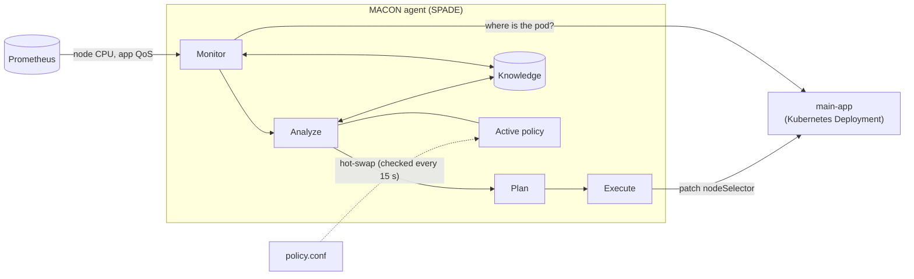

# MACON Agent

**An autonomous Kubernetes agent that decides when and where to migrate a workload, and can change its own decision logic at runtime.**

This repository contains the reference implementation of the agent presented in:

> M. Loaiza, V. Barbuto, C. Savaglio, R. Gravina. *MACON: Autonomous MAPE-K-Based Orchestration Across the Edge–Cloud Continuum.* ICON 2026 (International Workshop on IoT Applications and Cyber-Physical Systems in the Edge–Cloud Continuum), co-located with IEEE NCA 2026.
> <!-- TODO: add DOI / PDF link when available -->

The agent follows a **MAPE-K** loop (Monitor, Analyze, Plan, Execute over a shared Knowledge base). It observes the QoS of an application and the CPU load of the cluster nodes, then migrates the application between nodes when its active policy says so. The policy is a plug-in: you can **hot-swap it while the agent is running**, with no restart, and compare strategies under identical, controlled stress.

---

## Why this project

Edge–cloud workloads need to move between nodes as conditions change, and no single decision strategy is best in every situation. This project makes the strategy a first-class, replaceable component and ships an experimentation suite to measure how each one behaves (migrations, QoS violations, downtime).

## Architecture



| Behaviour | Type | Role |
|---|---|---|
| **Monitor** | Periodic (15 s) | Locates the pod through the Kubernetes API, queries Prometheus for node CPU and application QoS, and updates the knowledge base. |
| **Analyze** | Periodic (15 s) | Evaluates the active policy against the knowledge base and, if a migration is warranted, sets the target node and takes the migration lock. |
| **Plan** | One-shot | Reads the target node and hands over to Execute. |
| **Execute** | One-shot | Patches the Deployment's `nodeSelector` to trigger the migration, then releases the lock. |

A detailed walkthrough of the agent internals is in [`docs/agent-documentation.md`](docs/agent-documentation.md).

## Dynamic policies

The agent's decision logic is not hard-coded. It is loaded at runtime from `cluster/policies/`.

1. **Policy files.** Each policy lives in its own Python file in `cluster/policies/` and defines a `CustomPolicy` class.
2. **The switch.** `cluster/policy.conf` contains a single line: the filename of the active policy (e.g. `weights.py`).
3. **Hot-swapping.** The Monitor checks `policy.conf` every 15 seconds. When the filename changes, the agent loads, compiles and instantiates the new `CustomPolicy`, and uses it from the next cycle on.

| Policy | File | Idea |
|---|---|---|
| Threshold heuristic | `threshold.py` | Migrate when a metric crosses a fixed threshold. <!-- TODO: confirm --> |

<!-- TODO: document the interface a policy must implement (method names, inputs, expected return value) so others can write their own. -->

## Repository structure

```
.
├── cluster/              # The agent
│   ├── cluster_agent.py  # MAPE-K agent (SPADE)
│   ├── policies/         # Pluggable decision policies
│   ├── policy.conf       # Name of the active policy (hot-swappable)
│   ├── metrics.conf      # Metrics configuration
│   └── models/           # Trained ML models
├── experiments/          # Experiment orchestration, training and analysis
│   ├── test_runner_agent.py
│   ├── train_model.py
│   ├── policy_comparison.py
│   ├── data_collector.py
│   ├── gen_charts.py
│   ├── preflight_check.py
│   ├── stressor.yaml
│   ├── training_data/
│   └── comparison_results/
└── docs/
    └── agent-documentation.md
```

## Getting started

### Prerequisites

- A Kubernetes cluster with at least two nodes and a Deployment named `main-app`.
- A Prometheus instance that exposes node CPU and an application QoS metric (`main_app_qos`).
- Python <!-- TODO: version -->, with the dependencies listed in <!-- TODO: requirements file path -->.

### Run the agent

```bash
# 1. Choose the initial policy
echo "threshold.py" > cluster/policy.conf

# 2. Start the agent
python cluster/cluster_agent.py
```

### Switch policy while it is running

```bash
echo "weights.py" > cluster/policy.conf
```

Within 15 seconds the agent loads the new policy and keeps running.

<!-- TODO: explain where the Prometheus URL, namespace and deployment name are configured. -->

## Experiments

The `experiments/` directory contains the tooling used to evaluate the policies.

- **`test_runner_agent.py`** runs long, repeatable experiments. It applies a cyclical CPU load (`cpu-wave`, see `stressor.yaml`) to a chosen node and records, per run: `migration_count`, `qos_violation_seconds` and `downtime_seconds` (measured with an external health check). Results are saved as one JSON file per run.
- **`train_model.py`** trains the model used by the ML-based policy from the collected data.
- **`policy_comparison.py`, `gen_charts.py`, `data_collector.py`, `preflight_check.py`** <!-- TODO: one-line description of each -->

```bash
# Example: 3 repetitions of a 1-hour test for the weights policy.
# The agent must already be running with that policy active.
python experiments/test_runner_agent.py \
  --policy "weights-policy" \
  --num-repetitions 3 \
  --duration 3600 \
  --node-ip 192.168.0.15
```

## Results

<!-- TODO: fill with the numbers from the paper / comparison_results, and link the figures. -->

| Policy | Mean QoS | Time at QoS > 80 (s) |
|---|---|---|
| Threshold (MACON) | 98.06 | 96.7 |
| Baseline (no Op) | 58.99 | 47.1 |

## Related projects

- [MLSysOps](https://mlsysops.eu/) <!-- TODO: confirm URL --> : the Horizon Europe project this work was developed in.

## Citation

If you use this code, please cite the paper:

```bibtex
@inproceedings{loaiza2026macon,
  title     = {{MACON}: Autonomous {MAPE-K}-Based Orchestration Across the Edge--Cloud Continuum},
  author    = {Loaiza, Marco and Barbuto, Vincenzo and Savaglio, Claudio and Gravina, Raffaele},
  booktitle = {International Workshop on IoT Applications and Cyber-Physical Systems in the Edge--Cloud Continuum},
  year      = {2026}
}
```

<!-- TODO: add pages / DOI. -->

## Project Presentation

📄 [View Project Presentation (PDF)](docs/presentation.pdf)

## Acknowledgments

This work benefited from the support, guidance, and technical contributions of the research community and collaborators involved in its development.
Special thanks to the researchers, UNICAL, and open-source communities whose work and resources contributed to this project.
